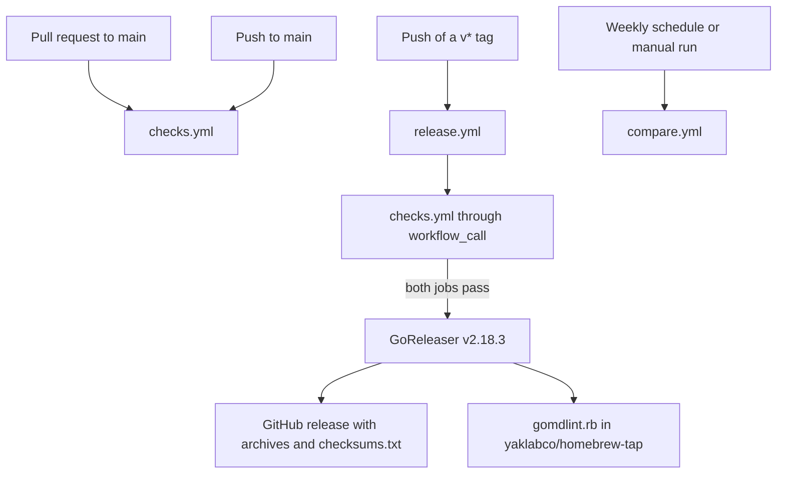

# CI/CD

This document describes the continuous integration checks and the release
process for gomdlint. Three GitHub Actions workflows live in
`.github/workflows`. GoReleaser builds and publishes each release from
`.goreleaser.yml`. A release starts when a maintainer pushes a version tag.
No bot opens release pull requests or creates tags.

## Overview



## Workflows

### checks.yml

`checks.yml` runs on every push to `main`, on every pull request that
targets `main`, and when `release.yml` calls it. A newer run for the same
ref cancels an older one. The workflow token is read-only.

The `test` job runs these steps in order:

1. `gofmt -l .` lists unformatted files, and the step fails if it finds any.
2. `go vet ./...` runs the standard vet analyzers.
3. golangci-lint v2.11.4 runs with the settings in `.golangci.yml`.
4. `go build` compiles `./cmd/gomdlint`.
5. `go run ./cmd/gomdlint lint --strict` lints `README.md`, `CHANGELOG.md`,
   `CI_CD.md`, `docs`, `CLAUDE.md` and `AGENTS.md` with the repository's
   `.gomdlint.yml`. With `--strict`, a warning or an error fails the job,
   while an info finding does not. blanks-around-tables (MD058) is the only
   rule whose default severity is info, and `.gomdlint.yml` raises it to a
   warning, so every finding in these files fails the job.
6. `go test -race` runs every test with the race detector and writes
   `coverage.out`.
7. `go mod tidy` runs, and the step fails if `go.mod` or `go.sum` changes.
8. The cross-compile step builds `./cmd/gomdlint` with `CGO_ENABLED=0` for
   the ten release platforms.

The `govulncheck` job runs govulncheck v1.9.0 on `./...`. It fails when code
in this module can reach a known vulnerability in a dependency or in the
standard library of the Go toolchain from `go.mod`. govulncheck also lists
vulnerabilities in imported packages whose affected functions gomdlint never
calls. Those do not fail the job.

### release.yml

`release.yml` runs when a maintainer pushes a tag that matches `v*`. Its
`checks` job calls `checks.yml`, so a release runs the same `test` and
`govulncheck` jobs as a pull request. The `release` job needs the `checks`
job and runs only when both of its jobs pass. A tag on a commit that fails
the checks publishes nothing.

The `release` job is the only job with `contents: write`. It checks out the
full history so that GoReleaser can read the tags. It installs Go from
`go.mod` without restoring a cache. It then runs GoReleaser v2.18.3 with
`release --clean`.

### compare.yml

`compare.yml` benchmarks gomdlint against markdownlint-cli every Sunday at
03:00 UTC and when it is started by hand. It builds gomdlint, installs
markdownlint-cli from npm, and clones the repositories listed in
`bench/repos.txt` into a cached directory. It then runs
`bench/scripts/run-bench.sh` and `bench/scripts/generate-plots.sh`. The
workflow uploads `bench/results/` as the artifact
`comparison-results-<run number>` and keeps it for 90 days.
`stave bench:compare` runs the same comparison locally.

GitHub disables a scheduled workflow after 60 days without activity in the
repository. When that happens, the weekly runs stop until someone enables
the workflow again, for example with `gh workflow enable compare.yml`.

## GoReleaser

`.goreleaser.yml` defines what a release contains.

- Before the build, hooks generate bash, zsh and fish completions into
  `.buildcache/completions`.
- GoReleaser builds with `CGO_ENABLED=0` for Linux, macOS, Windows and
  FreeBSD on amd64 and arm64, and for OpenBSD and NetBSD on amd64.
- The linker flags strip debug information and set `main.version`,
  `main.commit` and `main.date`. `gomdlint version` prints these values. A
  plain `go build` reports `dev`, `none` and `unknown`.
- Archives are named `gomdlint_<version>_<Os>_<arch>`, with `x86_64` in
  place of amd64. Windows archives are zip files and the others are tar.gz
  files. Each archive holds the binary, `LICENSE`, `README.md` and a
  `completions` directory.
- `checksums.txt` lists the SHA-256 sum of every archive.
- The GitHub release is named `v<version>`. A tag with a prerelease suffix,
  such as `v1.0.0-rc.1`, produces a prerelease. GoReleaser's own changelog
  is disabled, and the release notes point to `CHANGELOG.md`.
- GoReleaser writes the Homebrew formula `gomdlint.rb` to the root of
  `yaklabco/homebrew-tap`. `brew install yaklabco/tap/gomdlint` installs it.

The formula comes from the `brews` section, which GoReleaser deprecates in
favour of `homebrew_casks`. `goreleaser check` therefore reports the
deprecation and exits with status 2. A move to a cask also needs a
`tap_migrations.json` entry and the removal of `gomdlint.rb` in the tap,
released together with the configuration change. Without both, users who
installed the formula stay on its last version.

## Go toolchain

`go.mod` sets two Go versions.

- `go 1.25.4` is the minimum Go version for anyone who imports the packages
  or runs `go install`. Raising it affects those users.
- `toolchain go1.26.9` selects the Go release that builds and tests
  gomdlint in this repository. setup-go installs that release and sets
  `GOTOOLCHAIN=local`. A local `go` command with the default
  `GOTOOLCHAIN=auto` downloads it on first use. Go ignores this line when
  gomdlint is a dependency of another module.

To move to a newer patch release, run `go get toolchain@<release>`, for
example `go get toolchain@go1.26.10`, and commit `go.mod`. golangci-lint
refuses to lint a module whose toolchain is newer than the Go release that
golangci-lint was built with. Before you move to a new minor release such as
go1.27, raise the golangci-lint version in `checks.yml` to a release built
with that Go version or a later one.

## Pinned tool versions

| Tool | Version | Where it is set |
| --- | --- | --- |
| Go toolchain | go1.26.9 | `toolchain` line in `go.mod` |
| golangci-lint | v2.11.4 | `version` input in `checks.yml` |
| govulncheck | v1.9.0 | `checks.yml` and `CI.Vuln` in `stavefile.go` |
| GoReleaser | v2.18.3 | `version` input in `release.yml` |

The workflows pin third-party actions to major version tags.

## Secrets and permissions

GitHub Actions provides `GITHUB_TOKEN`. Every workflow sets the default
token permissions to `contents: read`. The GoReleaser job raises them to
`contents: write` so that it can create the release and upload its assets.
Every checkout sets `persist-credentials: false`, so the token is not
written to `.git/config`.

`HOMEBREW_TAP_TOKEN` is a repository secret. It must hold a token that can
write the contents of `yaklabco/homebrew-tap`. GoReleaser publishes the
GitHub release before it updates the formula. If the token has expired or
cannot write to the tap, the formula step fails after the release is
already public, and the tap keeps the previous version. The v0.2.2 release
failed this way with `401 Bad credentials`. Rotate the secret before the
next tag. For a release that already failed at that step, edit
`gomdlint.rb` in the tap by hand with the new version and the sums from the
release's `checksums.txt`.

## Releasing a version

1. Add a section for the version to `CHANGELOG.md` in a pull request and
   merge it. The changelog follows the Keep a Changelog layout and is
   written by hand.
2. Tag the resulting commit on `main` with an annotated tag and push the
   tag.

   ```bash
   git tag -a v0.3.0 -m "Release v0.3.0"
   git push origin v0.3.0
   ```

3. Watch the Release workflow. The checks run first, and GoReleaser runs
   only after they pass.
4. Check the assets on the GitHub release and the version in `gomdlint.rb`
   in `yaklabco/homebrew-tap`.

If the checks fail, GoReleaser publishes nothing. Do not move or reuse a
pushed tag. The Go module proxy may already have recorded the tagged commit,
and a moved tag makes `go install` fail its checksum verification. Fix the
problem on `main` and tag the next patch version.

## Running the checks locally

`stave ci:gate` runs the checks from the `test` and `govulncheck` jobs in
sequence, apart from the Markdown lint. It uses the golangci-lint binary on
your `PATH`, which should be v2.11.4 or another release built with Go 1.26
or later. To lint the Markdown as CI does, run:

```bash
go run ./cmd/gomdlint lint --strict README.md CHANGELOG.md CI_CD.md docs CLAUDE.md AGENTS.md
```

To test the release configuration without publishing anything, run:

```bash
goreleaser check
goreleaser release --snapshot --clean --skip=publish
```

`goreleaser check` exits with status 2 while the `brews` deprecation
remains. The snapshot release writes every archive, `checksums.txt` and the
formula to `dist/`. It also leaves the generated completions in
`.buildcache/`.

## Troubleshooting

### golangci-lint says its Go version is lower than the targeted version

The golangci-lint binary was built with an older Go release than the
toolchain in `go.mod`. Install a newer golangci-lint locally. If CI reports
the error, raise the version in `checks.yml`.

### The tidy check fails

Run `go mod tidy` and commit the changes to `go.mod` and `go.sum`.

### The Homebrew formula step fails with 401 Bad credentials

The token in the `HOMEBREW_TAP_TOKEN` secret has expired or cannot write to
the tap. See [Secrets and permissions](#secrets-and-permissions).
