# gomdlint Architecture

This document describes the architectural design of gomdlint, a fast
Markdown linter with automatic fixing capabilities.

## Overview and Package Structure

gomdlint is built with a layered architecture that separates concerns across
clearly defined boundaries:

```text
cmd/gomdlint/           CLI entry point
internal/               Application-specific wiring (not importable)
  cli/                  Cobra command definitions and exit codes
  configloader/         Configuration discovery, merging and migration
  display/              Character columns and display paths for reporters
  editdistance/         Edit distance for rule name suggestions
  ignore/               gitignore-style matching for directory walks
  jsonc/                JSON with comments and trailing commas, as markdownlint-cli2 reads it
  logging/              Structured logging setup
  ui/                   Terminal output styling (Lipgloss)
pkg/                    Reusable library packages
  mdast/                Markdown AST types and the source span contract
  lint/                 Core linting engine, rule interface, registry, pipeline
  lint/mdscan/          Scanners for inline HTML and autolink literals
  lint/refs/            Reference definitions, usages and heading anchors
  lint/rules/           55 built-in rules, their catalog and their fix checks
  fix/                  Text edits, fix resolution, line endings and diffs
  parser/goldmark/      Goldmark-based parser implementation
  runner/               File discovery and concurrent processing
  reporter/             Output formatters (text, table, JSON, SARIF, diff, summary)
  analysis/             Result aggregation and statistics
  config/               Configuration data types
  fsutil/               Pinned file writes and backups
  langdetect/           Code block language detection
```

The key architectural principle: **interfaces live at the consumer layer**
(pkg/lint defines the Parser interface, not pkg/parser). This enables
dependency inversion. The engine depends on abstractions, not concrete
implementations.

## Core Interfaces

Four interfaces define the architecture's extension points:

### Rule Interface

`pkg/lint/rule.go` (`Rule`)

```go
type Rule interface {
    ID() string                    // "MD001"
    Name() string                  // "heading-increment"
    Description() string
    DefaultEnabled() bool
    DefaultSeverity() config.Severity
    Tags() []string
    CanFix() bool
    Apply(ctx *RuleContext) ([]Diagnostic, error)
}
```

The `init()` in `pkg/lint/rules/register.go` registers every built-in rule
through `RegisterAll`. The `BaseRule` embed provides default
implementations. Custom rules only need to implement `Apply()`.

A rule attaches fix edits to `Diagnostic.FixEdits`. The edits of one
diagnostic form one fix, applied together or not at all, and `"\n"` in their
text is written with the file's line ending.

### Parser Interface

`pkg/lint/parser.go` (`Parser`)

```go
type Parser interface {
    Parse(ctx context.Context, path string, content []byte) (*mdast.FileSnapshot, error)
}
```

Contract: deterministic, thread-safe, no side effects. Currently implemented
by the goldmark adapter in `pkg/parser/goldmark`.

### Reporter Interface

`pkg/reporter/reporter.go` (`Reporter`)

```go
type Reporter interface {
    Report(ctx context.Context, result *runner.Result) (int, error)
}
```

Bridges runner results to formatted output and returns the number of issues
reported. The exit code does not come from this count:
`cli.ExitCodeFromResult` computes it from the run's statistics.

### Renderer Interface

`pkg/reporter/renderer.go` (`Renderer`)

```go
type Renderer interface {
    Render(ctx context.Context, report *analysis.Report) error
}
```

Renders an aggregated `analysis.Report`. The summary format implements it,
and `reporter.New` wraps it in a facade that runs `analysis.Analyze` first.
The text, table, JSON, SARIF and diff formats implement `Reporter`
directly.

## Data Flow

The processing pipeline flows through seven stages:

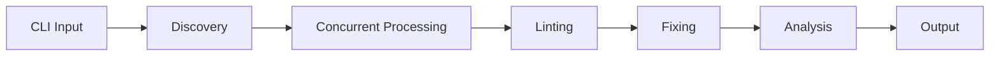

### Stage 1: CLI Entry

`cmd/gomdlint/main.go`

Cobra parses commands and flags. `internal/cli/lint.go:runLint()`
orchestrates everything. Commands attach an exit code to every error they
return (`internal/cli/exitcodes.go`), and an error without one comes from
Cobra's flag handling, which makes it a usage error (64).

### Stage 2: Configuration

`internal/configloader/`

Discovers the system, user and project config files and merges the layers,
lowest precedence first: built-in defaults, the system config, the user
config, the project config (or a markdownlint config translated for the
run), a file named with `--config` (which replaces project discovery),
environment variables (`GOMDLINT_*`) and command-line flags. The project
config is the first of `.gomdlint.yml`, `.gomdlint.yaml`, `gomdlint.yml`,
`gomdlint.yaml`, `.gomdlint.json` and `gomdlint.json` found in the nearest
directory that holds one, searching upward to a VCS root or the home
directory. A `.json` file is parsed as JSON and turned into the YAML node
tree that the loader decodes, so rule shorthands, rule options written
directly under the rule key, and warnings for unknown keys work the same way
in both formats. Each layer's rule keys are
normalized to rule IDs before the layers merge, so a rule configured under
two keys in one file is an error.

### Stage 3: File Discovery

`pkg/runner/discovery.go`

Recursively finds `.md` and `.markdown` files. Walks skip the trees that
`.gitignore` files ignore (`internal/ignore` reads them as Git does and
matches with Git's wildmatch rules), the `node_modules` and `vendor`
directories, and paths that the configured ignore patterns match, each
pattern resolved against the directory of the config file that set it.
Paths named on the command line are always linted. Paths that name one file
through hard links form one group.

### Stage 4: Concurrent Processing

`pkg/runner/runner.go`

Worker pool with `runtime.NumCPU()` goroutines (configurable via `--jobs`),
never more than there are groups of paths. Each unit of work is one group,
whose paths one worker processes in turn, so no two writes to one file
overlap. Each worker calls `Pipeline.ProcessFile()`. Results are collected
in deterministic order.

### Stage 5: Single-File Pipeline

`pkg/lint/pipeline.go` (`Pipeline.ProcessFile`)

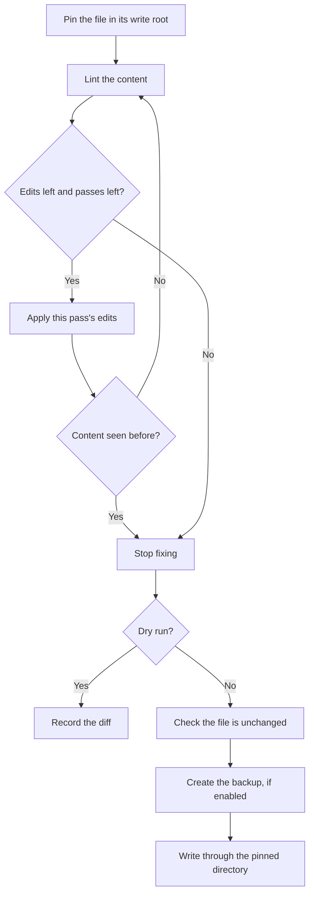

`fsutil.Pin` opens the file's directory as an `os.Root` inside its write
root, the linted path that contains the file, and keeps the file it read
open. The pipeline then lints and fixes pass by pass. Each pass applies the
edits the engine selected and lints the result again, so the next pass
works on fresh findings. The loop stops when no edits remain, when the
content repeats an earlier pass (`Oscillated`), or at the pass limit
(`Exhausted`). Unless `PipelineOptions.MaxFixPasses` sets one, the limit is
`DefaultMaxFixPasses` (10) plus one for each registered rule that can fix,
because each pass applies the fixes of one rule per top-level block.
Content that cannot be linted again is never written.

Before the backup and the write, the pipeline checks that the path still
leads to the pinned file and that the file still holds the content it read.
Otherwise it refuses the write and reports the original lint result. The
backup and the write check the file again themselves, and refuse with
`fsutil.ErrFileChanged`. On Linux the write commits with
`renameat2(RENAME_EXCHANGE)` through the pinned directory, and elsewhere
with a checked rename. A file with several hard links is rewritten in
place. A backup is hard-linked into place, so an existing backup is never
replaced. A file reached through a symbolic link whose target lies outside
the linted paths is linted but not fixed. `PinnedFile` documents the
windows that remain on platforms without `RENAME_EXCHANGE`.

### Stage 6: Lint Engine

`pkg/lint/engine.go` (`Engine.LintFile`)

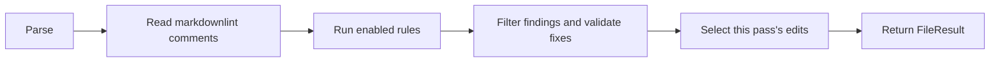

The engine parses the content, collects its markdownlint comments, applies
any `markdownlint-configure-file` settings, and works out which rules are
on at each line. It runs each enabled rule and records an error the rule
returns, a recovered panic (`ErrRulePanic`) or an invalid fix
(`ErrInvalidFix`) as a `RuleError` for that rule alone. It drops findings on
lines where their rule is disabled, applies the resolved severity, and
validates each finding's fix. A finding keeps its fix only when `--fix`
would apply it (`ResolvedRule.Fixable`), and newlines in fix text are
written with the file's dominant line ending (`fix.DetectLineEnding`).
Finally the engine selects the edits for this pass (see
[Fix Engine](#fix-engine)) and returns a `FileResult` with the diagnostics,
`Edits`, `DeferredEdits`, `SkippedEdits`, `RuleErrors` and `Notices`.

### Stage 7: Output

`pkg/reporter/`

The selected reporter formats the runner's result (see
[Reporters](#reporters)). The CLI writes config warnings, notices, fixes
that were not written and rule failures to stderr after the report, so
every output format shows them and stdout holds only the report.

## Parser and Source Spans

`pkg/parser/goldmark`, `pkg/mdast`

The parser maps goldmark's tree onto `mdast` nodes. goldmark records only
the lines of a block's content, so the parser wraps goldmark's block
parsers, inline parsers and paragraph transformers (`spans.go`) to record
where each construct opens and which lines it owns. Every node then carries
two byte ranges into the content: its full span, which includes its syntax
markers, and its content span inside them. The contract for each node kind
is the package documentation of `pkg/mdast`. Spans are half-open byte
ranges, a child's full span lies inside its parent's, siblings never
overlap, and block spans start after any container prefix, such as the `>`
of a blockquote.

The parser also reads the real ordered list delimiter and fence character,
parses past a leading byte order mark with stable offsets, records each
link's reference style and its label without container prefixes, and gives
strikethrough, tables and task checkboxes node kinds of their own. Token
ranges are derived from the spans. Code, HTML block and front matter tokens
follow the parse, while other markers are recognized line by line, so rules
use spans for structure. The `gfm` flavor adds goldmark's linkify, table
and strikethrough extensions and a task list extension of its own, which
reads a checkbox where micromark does (`GFMExtensions`). Every goldmark
instance that a fix check builds for GFM uses the same extensions, so the
checks and the rules read the same checkboxes. `commonmark` adds none.

goldmark 1.8 gives each link reference definition a node, which the mapper
leaves out of the tree. It also reads some lists as loose that CommonMark
reads as tight, so `ListTight` and `ListItemLoose` report tightness as
CommonMark does. goldmark builds a GFM table from a paragraph without the
paragraph's blank-line flag, so the parser gives the table that flag when
the table takes the paragraph's first line, unless link reference
definitions came off the paragraph's start. A list item that gains a blank
line before a table then reads as loose, as in CommonMark.
`Parser.ParseWithReferences` parses part of a document with the document's
definitions, for the region checks below.

Helpers in `pkg/lint/source.go` give rule fixes the container prefix of a
line measured in CommonMark columns (`ContainerPrefix`), blank-line checks
that see through `>` markers, and the text that adds a blank line inside a
blockquote (`BlankLineText`). `pkg/lint/refs` collects reference
definitions, the references that the parser leaves as text, and heading
anchors built as GitHub builds them. `pkg/lint/mdscan` matches HTML
constructs and GFM autolink literals. The HTML rules find the tags of an
HTML block as markdownlint does, by parsing the block's lines again as
Markdown without HTML blocks and indented code
(`pkg/lint/rules/html_block_markdown.go`, with the parser from
`NewHTMLBlockContent`), leaving out tags in math and marking tags in
tables. Rules that markdownlint runs on its micromark parse read math the
way micromark-extension-math does (`pkg/lint/rules/math.go`), since
goldmark reads none.

## Fix Engine

`pkg/fix`, `pkg/lint/engine.go`, `pkg/lint/blocks.go`

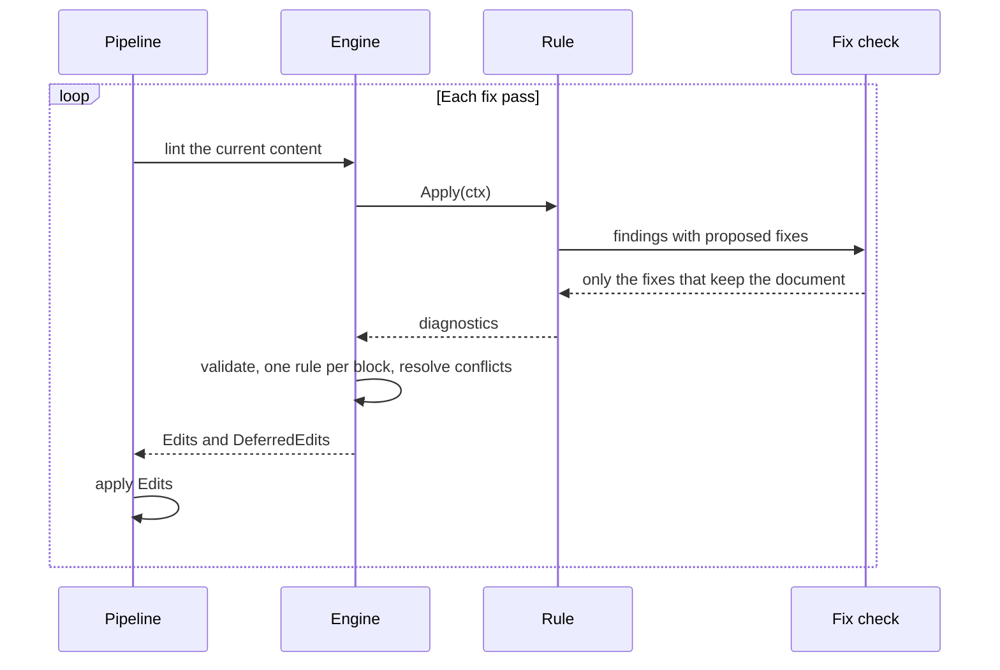

A rule proposes one fix per finding as a set of `fix.TextEdit` byte ranges.
`fix.Validator` checks each fix on its own: every edit lies within the
content, no two edits overlap, and no edit splits a CRLF pair or a UTF-8
character. An invalid fix is dropped from its finding only.

The engine then withholds every fix that changes or makes a possible task
list checkbox (`pkg/lint/checkbox_guard.go`), whatever rule offers it, and
reports its finding without a fix. micromark and GitHub's cmark-gfm read
checkboxes in different places, so the guard reads no renderer's rules.
It takes a lexical superset of both: in a list item's first lines up to a
blank line or the next item, a line whose text starts with `[`, one
character or a line ending, and `]`. A fix may not change the text from the
start of the item's marker line through the line after the one holding the
`]`, join that marker line to the line before, or leave the lines around it
with a candidate they did not have.

Fixes of different rules can each be safe and still corrupt a file
together. One rule removing `$` prompts in a code block while another
changes its fences from tildes to backticks turns the line `` $ ``` `` into
a closing fence. So in each pass the engine applies, per top-level block, the
fixes of one rule only, the lowest rule ID with a fix there (`selectEdits`).
A block is the front matter, or a run of non-blank lines joined with further
runs that one top-level node's full span covers. A run whose first line is
indented joins the run before it too, because a fix in either could decide
whether that line continues a list item (`newTopLevelBlocks`). The other
rules' fixes in a block become `DeferredEdits`, and the pipeline lints the
fixed content so that those rules derive and check their fixes again. Fixes
that change nothing take no part in the choice, so they cannot hold a block
while other fixes wait.

`fix.ResolveFixes` resolves the chosen fixes against each other. A fix is
accepted whole or skipped whole, the earlier fix wins a conflict, and
overlapping pure deletions merge. Before that, a rule's own blank-line
insertions at one boundary merge into one edit that keeps a container
prefix such as `>`. Skipped and deferred fixes are proposed again in the
next pass.

`fix.GenerateDiff` builds the unified diff for `--format diff`. It compares
lines with their line endings, using Myers' algorithm in linear space with a
work budget for pathological inputs. Where a file lacks a final newline, it
prints `\ No newline at end of file`.

## Fix Checks

`pkg/lint/rules`

The engine checks that a fix is well formed. Whether it is safe is decided
in the rules package. Every fixing rule passes its findings through one of
three checkers. A checker applies the fixes, parses the result again with
the document's flavor, compares it with the original, and withholds any fix
that changes the document in a way the rule does not intend. The finding
stays, without its fix. Each checker checks fixes alone and together,
because the engine may apply any subset of them.

- `fixcheck.go` serves the heading, emphasis, thematic break and proper name
  rules: MD003, MD018 to MD023, MD026, MD035 to MD037, MD044, MD049 and
  MD050. Each rule states the change it means to make, such as removing
  trailing punctuation for MD026 or making a heading for MD036. The check
  compares the front matter and a summary of every block: its kind, heading
  level and style, list type and tightness, fence info, table alignment and
  nesting, and its rendered text with inline markup, resolved link
  destinations and titles, and raw HTML byte for byte. It does not emulate
  heading anchors. In a document that may refer to them, no fix may change
  the rendered text of a heading or add, remove or reorder headings.
- `fix_check.go` serves the list and whitespace rules, through
  `keepSafeFixes`: MD004, MD005, MD007, MD009, MD010, MD012, MD013, MD027,
  MD029, MD030, MD032 and MD047. It compares render signatures: the front
  matter, block kinds and nesting, heading levels with the anchors GitHub
  gives them, list kinds, start numbers and tightness, code and raw HTML
  byte for byte, resolved link destinations and titles, task checkboxes, and
  inline text with the whitespace that HTML collapses. With the
  `commonmark` flavor it also parses as GFM. A document whose raw
  HTML is anything other than whitespace, well-formed comments, and start
  tags of `br`, `wbr`, `hr` and `img` with only the presentational
  attributes that `benignAttribute` allows, each used once (`benignHTML`),
  keeps none of these rules' fixes, because no signature models how a style
  sheet, an event handler or an element left open changes the page.
  `list_fix_safety.go` plans list item moves together, so that moves which
  are only safe together form one fix.
- `fix_safety.go` serves the code, link, reference and table rules, through
  `verifyFixes`: MD011, MD014, MD031, MD034, MD038 to MD040, MD048, MD053,
  MD058 and MDL003. Each rule names the one change its fix may make
  (`fixAllowance`), such as adding a fence's info string or removing a
  prompt. The check compares outlines: the front matter, block kinds and
  nesting, heading levels, list type, start and tightness, code block kind,
  info and lines, table alignments, decoded rendered text, link
  destinations, titles and labels, autolinks, raw HTML and heading anchors.
  An edit that cannot change block syntax is checked with the other fixes in
  its leaf block, any other edit with every fix in the top-level blocks it
  touches, and a batch that fails is halved until the remaining fixes pass.

### Region Checks

Parsing the whole document for every fix makes lint time grow with the
square of the document's length when there are many findings. So the
checks of `fix_check.go` and `fix_safety.go` parse only the part of the
document an edit can affect. A recording parse of the original
(`docLayout` in `fix_regions.go`) notes the lines where goldmark starts a
group of blocks whose parse no longer depends on what came before: a line
where it opens a block with no block open, or a top-level block right after
a closed thematic break, ATX heading or one-line HTML block. It also notes
where each item of a top-level list starts and which paragraph each link
reference definition comes from.

A check parses the groups that hold its edits, followed by a sentinel line
that must start a group the way the original's next group starts, or,
inside a long list, the edited items with the item before and the item
after them. It splices the result into the original's render signature
(`fix_region_model.go`) or outline (`fix_safety_regions.go`) and compares
exactly. It parses the whole document, as before, when an edit changes link
reference definitions or can reach the front matter, or, for the render
signature, when a region changes the anchor counts after it.
`fix_anchors.go` works out how the anchors of headings change. `fixcheck.go`
finds references to heading anchors in one pass over the document.

The safety argument, why a region check decides exactly as a check of the
whole document would, is the top comment of
`pkg/lint/rules/fix_regions.go`. Two shapes still cost a parse per fix: many
fixes inside one large block other than a top-level list, and fixes that
change link reference definitions.

## Rule Catalog and Registry

`pkg/lint/rules/catalog.go`, `pkg/lint/meta.go`, `pkg/lint/registry.go`

Every built-in rule has one catalog entry, a `lint.RuleMeta`, in the
`catalog_<category>.go` file of its category. An entry holds the rule's ID,
its canonical name, the markdownlint names that differ from it (`Aliases`),
markdownlint's first name where that differs (`MarkdownlintName`), its
category, markdownlint's tags for it, and whether it can fix. Categories
group the rules in documentation, such as the README's rule categories, and
are not accepted where a rule can be named. Rule listings such as
`gomdlint rules` are in rule ID order. A tag may cover several rules, as in
markdownlint. gomdlint's own rules, MDL001 and MDL003, take tags from
markdownlint's vocabulary. `RegisterAll` records each entry with
`Registry.Describe`. Catalog tests check that every registered rule has
exactly one entry, that names and fix flags match the rules, that each ID,
name and alias names one rule and no tag spells one of them, and that tags
and aliases equal markdownlint v0.41.0's table, which is stored as test
data.

The registry resolves names through the catalog:

- `Lookup` and `Resolve` find a rule by ID, name or alias, in any case,
  ignoring surrounding whitespace. Config keys and the rule flags use them.
- `Meta` returns a rule's catalog entry, and `RulesByTag` the rules a
  markdownlint tag covers.
- `Suggest` ranks the rules and tags that a key naming neither most likely
  means: typos within two edits first, using `internal/editdistance`, then
  substring matches. `Closest` and `ClosestRules` pick the best of them for
  error and warning messages, and none when more than three are equally
  close.

## Notices

`pkg/lint/notice.go`, `pkg/lint/directives.go`

A notice reports a problem in a file that changes no finding and no exit
code (`lint.Notice`). The engine records one for each word in a
markdownlint comment that names no rule or tag (`NoticeUnknownRule`, with
the closest suggestions), and for each use of one of gomdlint's former tags
(`NoticeDeprecatedTag`, with the rules it covers). A
`markdownlint-configure-file` comment never fails the file. It gets a
notice for each key that names no rule, for each option that its rules do
not read (`NoticeUnknownOption`), for each option written in gomdlint's
spelling beside markdownlint's (`NoticeOptionConflict`), and for holding no
object of settings (`NoticeInvalidConfiguration`). A configure-file comment
without a `-->` of its own runs on to that of a later comment, so the
engine reads such comments only while their text comes to at most four
times the file's length and 1 MiB more, and gives each of the rest a notice
(`NoticeUnreadConfiguration`), so a file lints in time in proportion to its
length. Comments are read with markdownlint 0.41.1's grammar: the comment's
kind must be followed by whitespace or `-->`, and words fold case as
JavaScript's `toUpperCase` does. Notices travel in `FileResult.Notices` and
`runner.FileOutcome.Notices`. The CLI writes them to stderr, JSON output
lists them under each file's `notices`, and SARIF output records them as
`toolConfigurationNotifications` at level warning, which leave
`executionSuccessful` true.

## Reporters

`pkg/reporter`, `internal/display`, `internal/ui/pretty`

`reporter.New` picks the reporter for `--format`:

- `text` (`TextReporter`): each file's findings with location, severity,
  rule and message in columns padded in terminal cells, then the source line
  with a caret under the column, and the suggestion.
- `table` (`TableReporter`): one row per finding with an `E`, `W` or `I`
  marker and `+` for a fixable finding, cut by display width and narrowed to
  fit the terminal.
- `summary` (`SummaryRenderer`): counts per rule and per file, through
  `analysis.Analyze`, highest count first, with ties in rule ID and path
  order.
- `json` (`JSONReporter`): files, diagnostics with their fixes as byte
  offsets, rule errors, notices and a summary.
- `sarif` (`SARIFReporter`): SARIF 2.1.0 with artifact URIs relative to
  `%SRCROOT%`, the root of the Git working tree, regions in UTF-16 code
  units, one artifact change per fix, rule descriptors from the registry,
  and notifications for unreadable files and failing rules.
- `diff` (`DiffReporter`): the unified diff the pipeline recorded, of the
  fixes `--fix` would make or, with `--fix`, made.

Positions stay byte offsets inside the linter. Reporters convert them at the
boundary, from the file snapshot the diagnostics were computed against.
`internal/display` turns byte columns into 1-based character columns, or
UTF-16 code units for SARIF, skipping a leading byte order mark, and paths
into paths relative to the working directory. The runner sorts each file's
findings before any reporter sees them. `--rule-format` names rules by
name, ID or both in text, table and summary output.

## Design Patterns

The codebase employs several well-established patterns:

### Registry Pattern

`pkg/lint/registry.go`

`DefaultRegistry` is a thread-safe singleton (protected by `sync.RWMutex`).
Rules self-register via `init()` functions, each with a catalog entry (see
[Rule Catalog and Registry](#rule-catalog-and-registry)). Messages that
name a rule name it by name, then ID, as in `no-trailing-spaces (MD009)`.

### Strategy Pattern

- **Parsers**: `lint.Parser` interface allows swappable implementations
- **Reporters**: Six output strategies selected at runtime by `--format`
- **Rules**: Each rule is a strategy for detecting a specific violation

### Builder Pattern

`pkg/lint/diagnostic_builder.go`

```go
lint.NewDiagnostic(r.ID(), node, message).
    WithSeverity(severity).
    WithSuggestion("Use ATX headings").
    WithEdit(fix.TextEdit{...}).
    Build()
```

Also `fix.EditBuilder` for accumulating text edits.

### Pipeline Pattern

`pkg/lint/pipeline.go`

Multi-stage processing: pin → lint → fix passes → check → backup → write.
Each stage can fail independently with proper error propagation.

### Worker Pool Pattern

`pkg/runner/runner.go`

Fixed goroutine count processing from a work channel. Context-aware cancellation
throughout.

### Dependency Injection

- Engine receives Parser and Registry
- Pipeline receives Engine
- Runner receives Pipeline
- Enables testing with mock implementations

### Visitor Pattern

`pkg/mdast/walk.go`

`Walk()` traverses AST in pre-order. Helper functions like `lint.Headings()`,
`lint.Paragraphs()` simplify rule implementation.

## Layer Architecture

The system is organized into eight distinct layers with clear responsibilities:

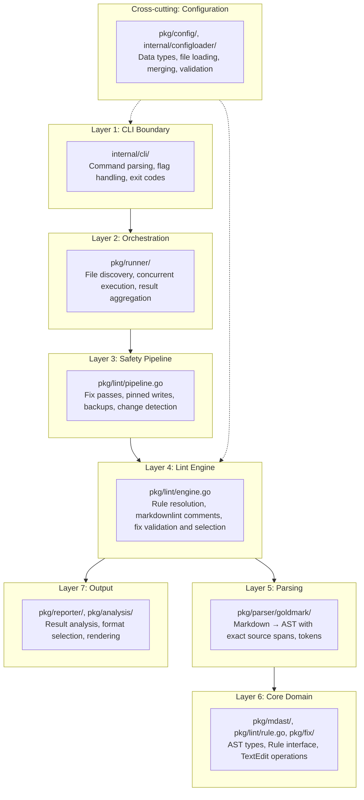

**Key constraint**: Dependencies flow downward only. Higher layers depend on
lower layers, never the reverse. The `internal/` packages are
application-specific and cannot be imported by external consumers.

## Extension Points

The architecture provides four primary extension points:

### Adding a New Rule

`pkg/lint/rules/`

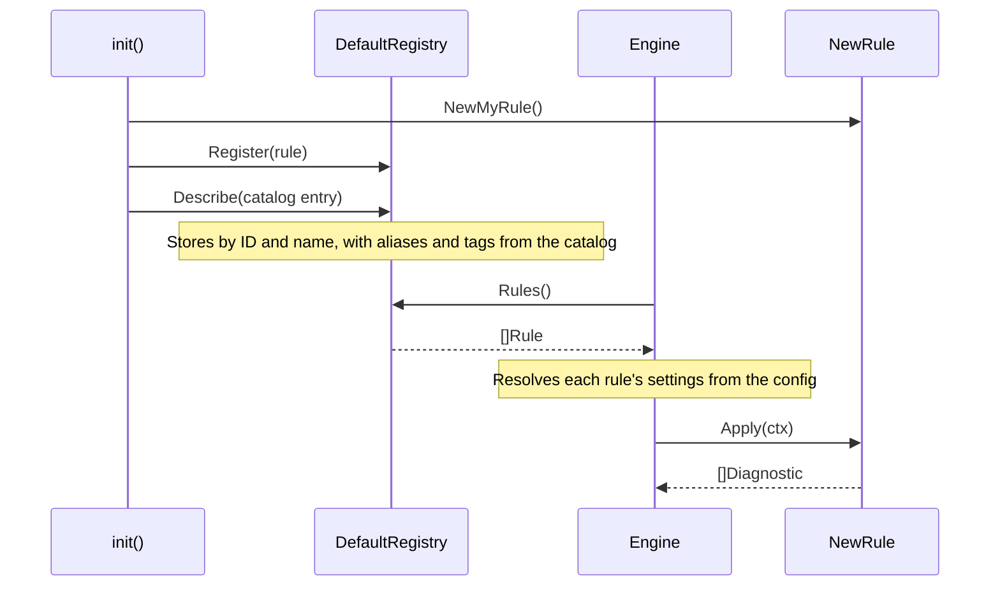

Steps:

1. Create file in `pkg/lint/rules/` (e.g., `my_rule.go`)
2. Embed `lint.BaseRule` for default implementations
3. Implement `Apply(ctx *RuleContext) ([]Diagnostic, error)`
4. Register in `register.go`: `registry.Register(NewMyRule())`
5. Add its catalog entry to the `catalog_<category>.go` file of its category:
   ID, name, markdownlint aliases and tags, and whether it can fix
6. If the rule fixes, pass its diagnostics through the fix check of the
   family it belongs to before returning them
7. Add golden fixtures under `pkg/lint/rules/testdata/<RULE_ID>/` (see
   [golden-test-methodology.md](golden-test-methodology.md))

### Adding a New Output Format

`pkg/reporter/`

1. Implement `Reporter`, or a `Renderer` over `analysis.Report` wrapped the
   way the summary format is
2. Add the format to `pkg/reporter/format.go` and to `config.OutputFormat`
   in `pkg/config/config.go`
3. Add it to the switch in `reporter.New`

### Adding a New Parser

`pkg/parser/`

1. Create new package implementing `lint.Parser` interface
2. Return fully-populated `*mdast.FileSnapshot` with tokens and AST, with
   node spans that follow the contract in package `mdast`
3. Wire in CLI to instantiate the new parser

The fix checks in `pkg/lint/rules` parse with goldmark, through
`pkg/parser/goldmark` or directly, whichever parser the engine uses.

### Adding Configuration Sources

`internal/configloader/`

Current sources: YAML and JSON files, environment variables and CLI flags.
New sources can be added by modifying the merge logic in configloader.

## Concurrency Model

The runner implements a worker pool pattern for parallel file processing:

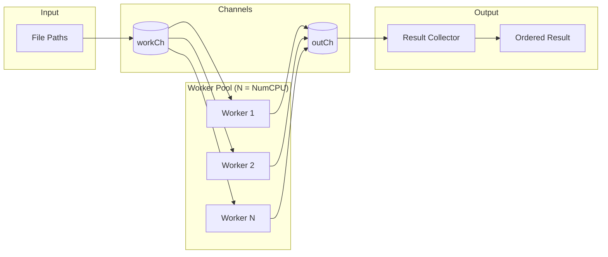

### Thread Safety Guarantees

| Component | Mechanism | Location |
| --- | --- | --- |
| Registry | `sync.RWMutex` | `pkg/lint/registry.go` (`Registry.mu`) |
| Parser | Stateless, concurrent-safe by contract | `pkg/lint/parser.go` |
| Engine | Stateless, no shared mutable state | `pkg/lint/engine.go` |
| Pipeline | Stateless, operates on isolated file data | `pkg/lint/pipeline.go` |
| Writes | One worker per file, however many paths name it | `pkg/runner/runner.go` |

### Context Propagation

All operations respect context cancellation:

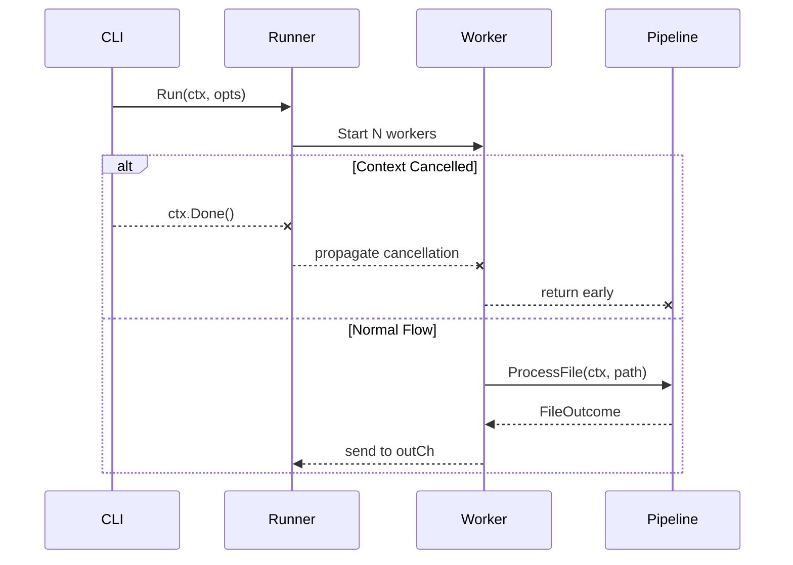

**Deterministic Output:** Results are collected into a map keyed by file
path, then output in sorted order regardless of worker completion order. The
runner also sorts each file's diagnostics by line, as markdownlint-cli2
does, then by column, rule ID and message, so the text, table, JSON and
SARIF reporters list findings in the same order. On one line,
markdownlint-cli2 orders findings by rule ID instead. The engine reports
them rule by rule. The summary format lists counts rather than findings,
and sorts its rules and files by count.

## Error Handling

Errors are categorized and handled at appropriate layers:

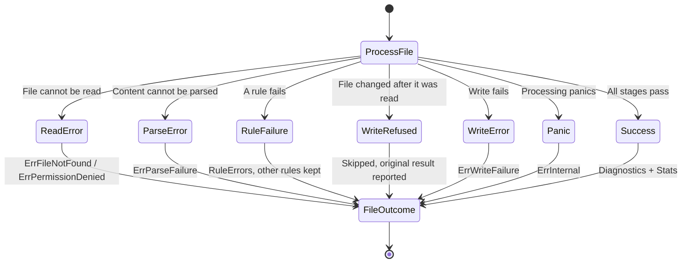

A file whose processing failed (`FileOutcome.Error`) makes the run exit 74,
unless the failure is a recovered panic (`ErrInternal`), which exits 70 like
a rule failure. When both kinds occur, 74 wins, and either wins over
findings (`cli.ExitCodeFromResult`).

### Pipeline Error Types

`pkg/lint/pipeline.go`

| Error | Cause | Recovery |
| --- | --- | --- |
| `ErrFileNotFound` | File doesn't exist | Skip file, report |
| `ErrPermissionDenied` | No read/write access | Skip file, report |
| `ErrParseFailure` | The content cannot be parsed | Skip file, report |
| `ErrWriteFailure` | Disk full, permissions | Report, preserve original |
| `ErrInternal` | Processing the file panicked | Report, continue with other files |
| `fsutil.ErrFileChanged` | The file changed between lint and write | Refuse the write, report the original result |

### Rule Execution Contract

- Rules return `error` only for internal failures, not for violations
- Violations are returned as `[]Diagnostic`, not errors
- An error, a recovered panic (`ErrRulePanic`, with its stack in the debug
  log) or an invalid fix (`ErrInvalidFix`) becomes a `RuleError` for that
  rule and file. Other rules' results stand, the file counts as failed, and
  the run exits 70

### Edit Conflict Resolution

`pkg/fix/resolve.go`, `pkg/lint/engine.go`

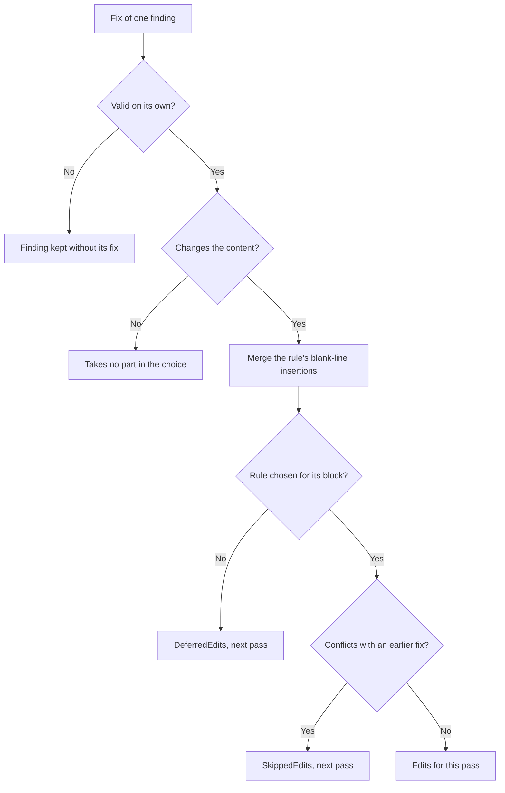

When fixes of one rule conflict, the earlier fix wins and the later one is
skipped whole. Overlapping pure deletions merge. Fixes of other rules in the
same top-level block wait for the next pass.

## Configuration Cascade

Configuration is resolved through a layered precedence system:

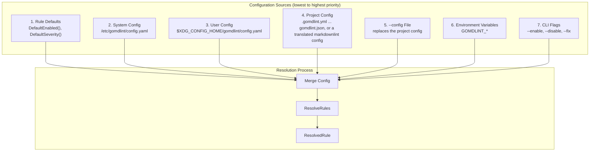

### Config File Discovery

`internal/configloader/`

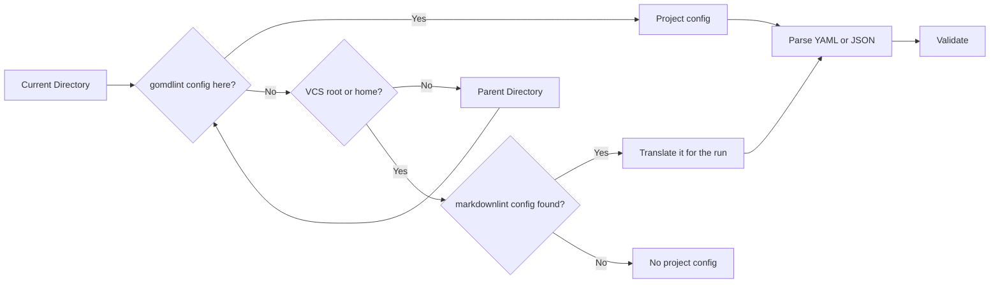

The system config (`/etc/gomdlint`, or `%ProgramData%\gomdlint` on Windows)
and the user config (`$XDG_CONFIG_HOME/gomdlint`) are looked up on their
own, as `config.yaml`, `config.yml` or `config.json`, and merged under the
project config. The markdownlint config is searched upward the same way,
and stands in for the project config only when there is none. `--config`
replaces project discovery. A markdownlint config is read as
markdownlint-cli2 reads one that it finds, whatever its name
(`lint.ReadMarkdownlintConfig`). The reader tries JSON with comments and
trailing commas first, which `internal/jsonc` blanks for the JSON decoder,
and YAML second. yaml.v3 parses the YAML into nodes, and
`pkg/lint/markdownlint_yaml.go` turns them into values as js-yaml 5.4.1's
core schema reads them for markdownlint-cli2: plain scalars as YAML 1.2
reads them, every key a string, a key written twice an error anywhere in
the document, only the core schema's tags, and no merge keys. It also
records the line of each key and item (`lint.MarkdownlintPosition`), which
warnings about options name, so loading and placing a warning read the keys
alike. gomdlint's own config files keep their own YAML decoder.

### Per-Rule Resolution

`pkg/lint/resolve.go` (`resolveRule`)

For each rule, the final configuration is computed:

| Property | Default | Config File | CLI Override |
| --- | --- | --- | --- |
| `enabled` | `rule.DefaultEnabled()`, true for every rule | `rules.X.enabled`, or `rules.X: false` | `--enable/--disable` |
| `severity` | `rule.DefaultSeverity()` | `severity_default`, then `rules.X.severity` | none (`--strict` changes the exit code) |
| `autoFix` | `rule.CanFix()` | `rules.X.auto_fix` | `--fix-rules` filter |
| `options` | Rule-specific | `rules.X.options.*` | none |

Migrated configs also write a `rule_defaults` layer, which applies after
`severity_default` and before `rules`. A migrated config holds nothing but
`rules` and `rule_defaults`, so the layers below it keep their other
settings.

**Rule Identification:** Config files accept a rule's ID (`MD001`), name
(`heading-increment`), or markdownlint alias (`ul-style` for MD004)
interchangeably, in any case, through `Registry.Lookup`. The `--enable`,
`--disable` and `--fix-rules` flags also accept markdownlint tags
(`whitespace`), which stand for every rule they cover, and the shell
completes all of these for them. A key or flag value that names no rule
gets a warning or error that suggests the closest rules. Inline markdownlint
comments, `markdownlint-configure-file` keys and the keys of markdownlint
configs resolve their words as markdownlint reads them, upper-cased as
JavaScript's `toUpperCase` does, with markdownlint's tags. One key per word
(`markdownlintKey` in `pkg/lint/directives.go`) serves those lookups, the
default key and the deduplication of notices. The lookup goes through an
index of every registered identifier and tag, and every catalog word, by
that key, so it compares letters beyond ASCII as markdownlint does. The keys
of a markdownlint configuration object apply in the order they are written,
which `lint.MarkdownlintSettings` keeps, and the configure-file comments of
a file merge into one such object first. A word that names
no rule or tag, and a former gomdlint tag that still resolves through the
rules' own `Tags()`, give the file a notice (see [Notices](#notices)).
Notices name rules as markdownlint does, by `RuleMeta.MarkdownlintName`
where a rule's own name is not markdownlint's first name, so that a comment
written from them works in both tools.

## Design Principles

| Principle | Implementation |
| --- | --- |
| **Separation of Concerns** | Clear layer boundaries; each package has single responsibility |
| **Dependency Inversion** | Interfaces defined at consumer layer (lint defines Parser, not parser) |
| **Immutability** | FileSnapshot is read-only; Diagnostics are final once built |
| **Determinism** | Sorted output; deterministic file ordering; reproducible results |
| **Safety First** | Fix checks; pinned writes; backups never replaced; refused writes when a file changed |
| **Extensibility** | New rules via init() registration; new formats via strategy pattern |
| **Testability** | Small interfaces; dependency injection; mockable components |
| **Fail Fast** | Validate early; categorized errors; context cancellation |
