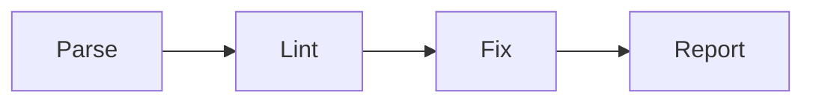
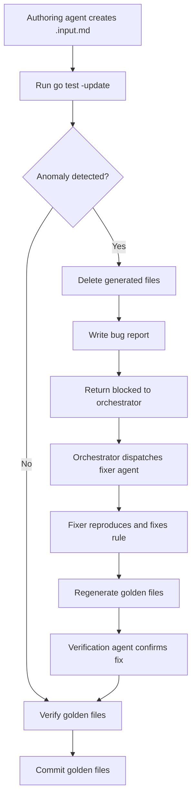

# Golden Test Methodology (With a twist)

## Introduction

This document describes how we built comprehensive golden test coverage for
gomdlint's 55 lint rules, and how we used AI agents to do most of the work.

Golden testing is a well-known technique: you capture the output of your
program, commit it, and fail the build if the output ever changes unexpectedly.
What makes this project interesting is the scale and the process. We needed ~170
carefully constructed markdown files, each designed to trigger exactly one rule
while avoiding false positives from the other 54. Writing those files requires
detailed knowledge of every rule's behavior, its edge cases, and the dozen or so
ways you can accidentally create a bad test input. That's a lot of domain
knowledge to hold in your head across 55 rules.

So we encoded that knowledge into three reusable [Claude
Code](https://docs.anthropic.com/en/docs/claude-code/overview) skills,
structured instruction files that agents load before doing work. The [gap
analysis skill](../.claude/skills/golden-test-gap-analysis.md) tells the agent
how to audit the codebase and figure out what's missing. The [authoring
skill](../.claude/skills/golden-test-authoring.md) tells it exactly how to
construct test inputs for each edge-case category (frontmatter, unicode, code
blocks, etc.) and what mistakes to avoid. The [verification
skill](../.claude/skills/golden-test-verification.md) gives it a checklist to
run after generating golden files. With those skills in place, we could dispatch
5 [sub-agents](https://docs.anthropic.com/en/docs/claude-code/sub-agents) in
parallel, each working on a different group of rules, and get consistent results
across all of them.

The output speaks for itself: 477 golden tests covering all 55 rules, a
round-trip idempotency guarantee on every fixable rule, and three real bugs
discovered and fixed in rule implementations along the way. The process also
exposed a gap in the original agent workflow. Agents had no protocol for
handling broken rules, which led to a second iteration that added inter-agent
bug detection, reporting, and repair.

This document covers the test system itself (how golden files work, what they
verify, why the round-trip test matters) and the agent-driven process we used to
create them (how the skills work, how we parallelized the effort, what went
right and what we learned).

## Why write another markdown linter?

Linters are deceptively hard to build well. Parsing is the easy part. The real
difficulty is in everything that comes after: tracking source positions
accurately through an abstract syntax tree (AST) that doesn't always preserve
them, generating edits that reference the right byte offsets in the original
document, applying multiple edits without one fix invalidating the offsets of
the next, and doing all of this without corrupting the file when something goes
wrong.

Markdown makes this harder than most languages. The CommonMark spec is over 600
pages of edge cases. Inline syntax (emphasis, links, code spans) interacts in
ways that surprise even experienced users. Different parsers disagree on
ambiguous constructs. And source positions from the parser are sometimes
approximate or missing entirely, as we discovered when goldmark's
`ThematicBreak` nodes turned out to have no line information at all.

The dominant tool in this space is David Anson's
[markdownlint](https://github.com/DavidAnson/markdownlint), a JavaScript library
(with the [markdownlint-cli2](https://github.com/DavidAnson/markdownlint-cli2)
CLI) that powers the widely-used VS Code extension and countless CI pipelines.
It's a well-maintained, battle-tested project with 53 rules in version 0.41, a
clean plugin API for custom rules, and a large community. If you need a markdown
linter today, markdownlint is the safe choice.

gomdlint was motivated by gaps that mattered for our specific use case:

**More auto-fix coverage.** markdownlint 0.41 supports auto-fix for 33 of its 53
rules (62%). Each fix is described by a single `fixInfo` object operating on one
line, and fixes are applied in a single pass. Conflicting edits on the same line
are skipped. gomdlint fixes 37 of 55 rules (67%) using byte-range edits
(`TextEdit`) that can span multiple lines, with a multi-pass loop that re-lints
after each pass so previously conflicting edits get a second chance. Each fix is
checked by parsing the fixed document again, and withheld if it would change the
document in a way its rule does not intend.

**Performance on large codebases.** Node.js has unavoidable startup overhead and
single-threaded execution. gomdlint compiles to a native binary and processes
files in parallel across all CPU cores. For a single file the difference is
negligible, but across a monorepo with thousands of markdown files, it adds up.

**Go-native integration.** We wanted something that could be `go install`-ed,
embedded as a library, and tested with standard Go tooling, not a Node.js
dependency in a Go project's CI pipeline.

None of this diminishes markdownlint's value. Anson has maintained it since
2015, driven a migration from markdown-it to micromark, and built an ecosystem
(VS Code extension, GitHub Actions, CLI tools) that gomdlint doesn't attempt to
replicate. gomdlint is a narrower tool: a fast, fixable-first linter for teams
that want Go-native tooling and aggressive auto-correction.

### By the numbers

| Aspect | gomdlint | markdownlint 0.41 |
| --- | --- | --- |
| Language | Go | JavaScript (Node.js) |
| Rules | 55 | 53 |
| Auto-fixable | 37 (67%) | 33 (62%) |
| Fix model | Byte-range `TextEdit`, multi-pass with conflict resolution, each fix checked by re-parsing | Line-based `fixInfo`, single-pass |
| Parser | goldmark (AST with exact source spans, plus a token stream) | micromark |
| Parallel execution | Worker pool, `NumCPU()` goroutines | Single-threaded |
| Output formats | text, table, JSON, SARIF, diff, summary | JSON, SARIF (via CLI) |
| Configuration | YAML or JSON (flavors, per-rule options) | JSON/YAML (per-rule options, custom rules) |
| Ecosystem | CLI, Go library | CLI, VS Code extension, GitHub Action, npm library, custom rule plugins |

## How gomdlint works

The processing pipeline has four stages:



**Parse.** A [goldmark](https://github.com/yuin/goldmark)-based parser converts
markdown into two parallel representations: an AST (`mdast.Node` tree) for
structural analysis, and a token stream (`[]mdast.Token`) that classifies every
byte in the source by kind, such as heading markers, list bullets, emphasis
markers, and code fences. Every node records its exact source span, markers
included, and the span of its content, so rules find both the structure (is this
heading inside a blockquote?) and the precise source position (where does its
marker start?) from the tree. The token stream answers byte-level questions
about the source.

**Lint.** Each enabled rule receives a `RuleContext` containing the parsed file,
configuration, and a lazy-initialized cache of typed node queries
(`ctx.Headings()`, `ctx.CodeBlocks()`, etc.). The rule inspects the document and
returns diagnostics. Fixable rules also populate an `EditBuilder` with
`TextEdit` values, byte-range replacements that describe how to correct each
violation. Before a rule returns, a fix check parses the document with its fixes
applied and withholds any fix that would change the document in a way the rule
does not intend.

**Fix.** Each fix is validated on its own: its edits must lie within the
document, must not overlap, and must not split a CRLF pair or a UTF-8 character.
In each pass, each top-level block gets the fixes of one rule, and the other
rules' fixes there wait for the next pass. The chosen fixes are resolved whole,
so the earlier of two conflicting fixes wins and the other is never half
applied, and overlapping deletions merge. The accepted edits are applied in
memory, and the result is re-parsed and re-linted. This loop repeats until no
edits are left, the content repeats an earlier pass, or the pass limit is
reached: 10 passes plus one for each rule that can fix (see
[#11](https://github.com/yaklabco/gomdlint/issues/11)). The multi-pass approach
handles cases where fixing one violation reveals or resolves another. The final
output is written through a pinned file handle, only while the file still holds
what was linted, with an optional backup.

**Report.** Results are rendered in one of six formats: human-readable text,
table, JSON, SARIF (for CI integration), unified diff, or statistical summary.

Files are processed in parallel across a worker pool sized to
`runtime.NumCPU()`. Each file goes through the full pipeline independently, with
results collected in deterministic order.

### Why the dual representation matters

Most markdown linters work from the AST alone. gomdlint added the token stream
because some rules needed information the AST didn't provide, or provided
incorrectly. For example, goldmark's `ThematicBreak` nodes have no source lines
(`Lines.Len() == 0`), but the tokenizer emits `TokThematicBreak` tokens with
byte offsets. The first MD035 fix (described later) fell back to the token
stream for that reason.

The parser has since learned to record where goldmark opens each block and which
lines it owns, so every node now carries a full span, markers included, and a
content span. Rules read thematic breaks, fences and setext underlines from the
tree, and token ranges are derived from those spans. The spans also matter for
fix generation. A rule that wants to change `__text__` to `*text*` needs to know
where the underscore markers are in the source bytes, not just that an emphasis
node exists in the AST, and the emphasis node's full span and content span say
exactly that.

## The Problem

When you change a rule's detection logic or fix generation, how do you know you
haven't broken something? Unit tests can check individual cases, but they don't
scale well, and they don't catch the subtle interaction between detection, fix
generation, edit merging, and re-parsing that makes autofix tricky.

We needed a test strategy that:

- Catches regressions in both diagnostics and fix output
- Verifies fixes don't corrupt documents
- Scales to hundreds of scenarios without writing hundreds of test functions
- Makes it obvious when behavior changes (intentionally or not)

And then we needed to actually create ~170 hand-crafted test input files across
all 55 rules, each one requiring knowledge of the specific rule's behavior, what
markdown constructs trigger it, and what pitfalls to avoid (like accidentally
triggering MD009 when you're trying to test MD012). Doing that by hand would be
tedious and error-prone. So we taught AI agents how to do it.

## How the Golden Tests Work

The golden test system is built on a simple file convention. Each scenario in a
rule directory such as `testdata/MD009/` is a set of files that share a name:

| File | Written by | Contents |
| --- | --- | --- |
| `basic.input.md` | you | The Markdown to lint |
| `basic.config.yml` | you, optional | The flavor and rule options for this scenario |
| `basic.golden.md` | `-update` | The expected output after applying all fixes |
| `basic.diags.json` | `-update` | The expected diagnostics |
| `basic.diags.txt` | `-update` | The same diagnostics, one readable line each |

You only ever write the `.input.md` file and, when a scenario needs one, the
`.config.yml` sidecar. Everything else is generated.

### The Generate-Then-Lock Workflow

When you create a new test case or change a rule:

```bash
# Regenerate golden files for a rule
go test ./pkg/lint/rules/ -run 'TestGoldenPerRule/MD009' -update
```

Put `-update` after the package path. `go test` stops reading package paths at
the first flag it does not know, so `go test -update ./pkg/lint/rules/` tests
the repository root instead.

This runs the rule against the input, captures the diagnostics and fixed output,
and writes them to disk. Decide what the rule should report and what the fix
should produce before you generate. For a rule that markdownlint also has, base
that on the markdownlint rule documentation. Then compare the generated files
with your expectation, and commit them only if they match.

From that point on, the golden files are locked. Any future change that produces
different diagnostics or different fix output will fail the test. You either fix
the regression or deliberately re-generate with `-update`.

### What Gets Tested

**TestGoldenPerRule** runs a single rule against each input file in its
directory, using the scenario's configuration. It checks two things:

1. The diagnostics match `diags.json` exactly: the same rule ID and name, line,
   column, message, severity, and fixability. The `diags.txt` file must match
   the same diagnostics.
2. After applying the fixes, the output matches `golden.md` byte-for-byte.

Each scenario is linted through `lint.Engine.LintFile`, the same entry point the
CLI pipeline calls on every pass, with fixes on and only the scenario's rules
enabled. Every other rule is replaced by an inert stand-in with the same ID,
name, tags, aliases and catalog entry, so inline directives resolve as in the
product but cannot make another rule report, not even a bare
`markdownlint-enable`. Severities, rule names and the preparation of fix edits
match the product as well. A per-rule scenario's `golden.md` is the input with
the fixes of that one engine pass applied: with a single rule running, the
engine defers no fix to a later pass. A rule error, or a diagnostic that carries
another rule's ID or name, fails the test. Each line of `diags.txt` shows the
position, severity, message, rule ID and name, and whether the diagnostic has a
fix:

```text
basic.input.md:3:30 warning Trailing whitespace (MD009/no-trailing-spaces) [fixable]
```

**TestGoldenRealWorld** runs every rule over the documents in
`testdata/real-world/`. Its `diags.json` holds the findings of one lint of the
input, sorted by line, column and rule. Its `golden.md` is the output of
`lint.Pipeline` with fixes on, the code path `--fix` takes: the pipeline applies
one pass of fixes, lints the result again and repeats, because the engine
applies only one rule's fixes to each top-level block in a pass and leaves the
others for the next one.

**TestGoldenRoundTrip** goes further, for every scenario, per-rule and
real-world alike. It fixes the input through `lint.Pipeline`, as `--fix` does,
re-parsing and re-linting after each pass. The test fails if the passes do not
converge, by reaching the pass limit or by producing content an earlier pass
produced, or if any fixable diagnostics remain. This catches a class of bugs
that are otherwise hard to detect:

- Fixes that shift byte offsets and break subsequent edits
- Fixes that introduce new violations
- Fixes that partially apply, leaving the document in a state that still
  triggers the rule

The round-trip guarantee means: **if the tool says it can fix something,
applying the fix actually fixes it.**

### Test Discovery

The test harness discovers cases automatically. Drop an `.input.md` file, with
an optional `.config.yml` sidecar, into `testdata/MD009/` and it gets picked up
on the next test run. No registration, no test function to write. The directory
name determines which rule runs. `testdata/MD009/` runs MD009, and
`testdata/real-world/` runs all enabled rules. A directory with any other name
has no runner, so `TestGoldenTestdataFiles` fails for its files.

### Per-Scenario Configuration

Without a sidecar, a scenario runs with the product defaults from
`config.NewConfig()`: the default Markdown flavor, `gfm`, and no rule options.
Such scenarios follow the product's default flavor, so they change when it changes.

A scenario that needs a different setup puts a sidecar next to its input, named
`<scenario>.config.yml`. The sidecar uses the `.gomdlint.yml` schema, limited to
two settings, so it is also a valid gomdlint config file:

- `flavor` is `commonmark` or `gfm`. The harness parses the input with this
  flavor and passes it to the rules in the configuration, so rules that check
  the flavor, such as the table rules, see it too.
- `rules.<RULE_ID>` holds options for one rule, in the shapes a config file
  accepts: under its `options` key, directly under the rule ID as
  markdownlint writes them, or both. An option may use gomdlint's name or
  markdownlint's. The engine passes them to the rule as it does options from
  a config file.

```yaml
# testdata/MD043/missing_heading.config.yml
rules:
  MD043:
    options:
      headings:
        - "# Project"
        - "## Overview"
        - "## Usage"
```

The same sidecar can drop the `options` level:

```yaml
rules:
  MD043:
    headings:
      - "# Project"
      - "## Overview"
      - "## Usage"
```

A scenario that depends on a flavor sets it explicitly, even when it matches the
current default. The GFM table scenarios set `flavor: gfm` for this reason.

A per-rule scenario runs only its directory's rule, and no other rule can report
in it. A real-world scenario runs the default-enabled rules, which are all the
rules, as in markdownlint. Rules such as MD043 and MD044 check nothing until
they are given options, so they report in a real-world scenario only when its
sidecar configures them. To reproduce a per-rule scenario with the CLI, pass the
sidecar with `--config`. The CLI also runs every other rule, so expect their
findings too.

The harness fails a scenario rather than ignore part of its sidecar. These
sidecars are rejected:

- A sidecar with any other key, such as a misspelled `flavour`, or with a rule
  setting such as `severity`, `enabled` or `auto_fix`.
- A sidecar with an invalid flavor or an unknown rule, or one that uses a rule
  name such as `proper-names` instead of the rule ID.
- An empty sidecar, a sidecar with more than one YAML document, or a rule entry
  without options.
- A rule entry with an option that the rule does not read, such as a
  misspelled `nmes`, a value or a list item of the wrong type, two spellings
  of one option, or one option set both under `options` and directly under
  the rule ID. The harness checks options against the rule's catalog entry,
  as a config file's warnings do.
- A sidecar that configures a rule the scenario does not run. A per-rule
  scenario runs only its directory's rule, and a real-world scenario runs the
  default-enabled rules.

`TestGoldenTestdataFiles` also fails for any file under `testdata` that belongs
to no scenario, because the harness would never read it. Examples are a sidecar
with a `.config.yaml` suffix, a sidecar or golden file without a matching
`.input.md`, a file in a nested directory, and a file in a directory that is
neither a rule ID nor `real-world`.

A string that an option does not allow, such as an unknown `style`, is
accepted, because rules read such a value as markdownlint does, so a scenario
can check how a rule treats one. When you add a sidecar, check that each option
changes the generated diagnostics or fixed output.

### Fix Application

The fix pipeline is the same one users get. Diagnostics produce `TextEdit`
values (byte offset ranges + replacement text), and the edits of one diagnostic
form one fix. The fixes go through:

1. **Fix check.** Before the rule returns, its fix check parses the document
   with the fixes applied and withholds any fix that would change the document
   in a way the rule does not intend.
2. **Validation.** Each fix on its own: its edits lie within the document, do
   not overlap, and do not split a CRLF pair or a UTF-8 character.
3. **Selection.** Each top-level block gets the fixes of one rule in a pass. The
   others are deferred to the next pass, which only real-world scenarios and
   round trips reach.
4. **Resolution.** Fixes are accepted or skipped whole, the earlier of two
   conflicting fixes wins, and overlapping deletions merge.
5. **Application.** Cursor-based splice of the original content.

This means the golden tests exercise the real fix pipeline, not a simplified
test double. If there's a bug in edit merging or offset calculation, a golden
test will catch it.

## How We Created 170 Test Files With Agents

We started with 23 rules that had golden tests and needed to get to 55, plus add
edge-case coverage for all of them. That's roughly 170 input files, each needing
to be carefully constructed markdown that triggers exactly one rule without
accidentally tripping others. Getting that right requires knowing things like:
always end with a newline (or you trigger MD047), don't use tabs (MD010), no
trailing whitespace (MD009), use proper heading hierarchy (MD001), and so on.

We used Claude Code agents to do this, but the interesting part is *how* we made
it reliable.

### The Skills

We wrote three project-specific skills (instruction files that agents load
before doing work) that encode the rules for golden test creation:

**golden-test-gap-analysis.** It tells the agent how to analyze the 55 rules,
read each implementation, check what test cases exist, and produce a coverage
report. It defines the edge-case categories (frontmatter, code_block_immunity,
unicode, etc.) and when each applies. The agent reads every rule's source code,
checks which ones call `ctx.IsLineInCodeBlock()`, which ones are fixable, and
maps out what's missing.

**golden-test-authoring.** This is the detailed rulebook for creating input
files. It specifies the file naming convention, content structure, size
guidelines, and templates for each edge-case category. Critically, it includes a
"common mistakes" table: don't accidentally use tabs, don't leave trailing
whitespace, always start with a heading, etc. These are the kinds of things that
cause cascading test failures when you get them wrong, and encoding them in a
skill means agents don't have to learn them the hard way.

**golden-test-verification.** This is the checklist agents follow after
generating golden files. Read the `.diags.json`, check the line numbers make
sense, verify `clean` cases produce zero diagnostics, verify
`code_block_immunity` cases produce zero diagnostics, run the round-trip test.
It also lists red flags: if a clean case produces diagnostics, the input has
accidental violations; if a round-trip test fails, the fix is non-idempotent.

### The Phased Approach

We broke the work into phases, each dispatching multiple agents in parallel:

**Phase 1, Gap Analysis.** One agent read all 55 rule implementations,
catalogued existing test coverage, and produced a coverage matrix. This told us
exactly what was missing: 32 rules had zero golden tests, and even the 23 that
had tests were missing edge-case categories.

**Phase 2, Basic + Clean.** Five agents ran in parallel, each handling a group
of rules (heading rules, list rules, link rules, etc.). Each agent created
`basic.input.md` and `clean.input.md` for its assigned rules, generated the
golden files with `-update`, read the output to verify correctness, and ran the
tests. By the end, all 55 rules had test directories.

**Phase 3, Edge Cases for Fixable Rules.** Five more agents in parallel. Each
one took a group of fixable rules and added frontmatter, code_block_immunity,
unicode, multiple, adjacent, and nested cases as applicable. This is where the
authoring skill really paid off. An agent working on MD009 (trailing whitespace)
needs to create a `unicode.input.md` with trailing spaces after multi-byte
characters like `你好` and `🎉`, and the skill tells it exactly how to structure that.

**Phase 4, Edge Cases for Non-Fixable Rules.** Three agents covered the
remaining rules. Non-fixable rules need fewer edge cases (no offset shifting to
worry about), so this phase focused on frontmatter and code_block_immunity scenarios.

**Phase 5, Full Verification.** Ran the complete test suite (477 golden tests +
the rest of the project's 2041 tests), confirmed everything passes, committed.

### Why Agents + Skills Worked Here

The key insight is that writing golden test input files is a task with very
precise rules that are easy to get wrong in subtle ways. A human writing
`frontmatter.input.md` for MD012 (no-multiple-blanks) might accidentally leave
trailing whitespace on a line, which would cause the generated diagnostics to
include MD009 violations, and the test would still pass (it only runs MD012),
but the input wouldn't be testing what you think it's testing.

The skills encode all of these constraints in one place. Every agent loads the
same authoring rules and verification checklist. That consistency is hard to
maintain across 170 files if you're writing them by hand over multiple sessions.

The parallel dispatch is the other big win. Five agents creating test files for
different rule groups simultaneously, with no file conflicts because each rule
has its own directory. The total wall-clock time for creating all the test files
was a fraction of what sequential work would have taken.

The agents also found real bugs in three rule implementations during the
process, but the initial approach to handling them was wrong. More on that in
the next section.

### Trust Model

The agents don't decide what's correct. The tool does. The workflow is:

1. Agent creates a `.input.md` file (following the skill's rules)
2. Agent runs `go test -update` to generate golden files from the *actual rule implementation*
3. Agent reads the generated diagnostics and fix output to verify they make sense
4. Agent runs `TestGoldenRoundTrip` to verify fix idempotence

The golden files are a snapshot of the tool's real behavior. If that behavior is
wrong, the golden test locks it in, and you fix the rule, not the test. The
agents verify that the snapshot is internally consistent (diagnostics match what
the code produces, fixes are idempotent), but they don't invent expected output.

But this trust model has a gap: it assumes the tool's behavior is correct. What
happens when it isn't? That's the problem we ran into next.

## What Went Wrong: Baselining Broken Behavior

The initial five-phase process had a critical flaw. When agents encountered
rules that produced wrong results, they had no protocol for handling it. They
accepted whatever the tool produced and committed it as the expected output.
This locked broken behavior into the test suite.

Three rules were affected:

**MD035 (HR style).** Goldmark's `ThematicBreak` AST nodes have no source
positions (`Lines.Len() == 0`). The rule's position check silently skipped every
thematic break, producing zero diagnostics for files with mixed HR styles. The
agent generated `basic.diags.json` as `[]`, an empty diagnostic array for a file
that clearly contained violations, and committed it.

**MD049/MD050 (emphasis/strong style).** `detectEmphasisStyle()` reads
`lineContent[pos.StartColumn-1]` expecting the marker character (`*` or `_`),
but goldmark's `SourcePosition` points to the emphasis *content*, not the
marker. The function returned `""` for every emphasis node, producing zero
diagnostics. Same root cause for strong emphasis. Both `basic.diags.json` files
were committed as `[]`.

**MD034 (bare URLs).** The autofix regex `(?:^|[^<(\[])(URL|EMAIL)(?:[^>\])]|$)`
uses boundary-consuming groups. After wrapping `user@example.com` in angle
brackets, the consumed boundary character shifts the capture indices. The regex
matches `ser@example.co` inside the already-wrapped email, producing a false
positive that corrupts the document. The agent noticed this during round-trip
testing and worked around it by avoiding email test patterns entirely.

In all three cases, the agents noticed something was wrong but had no mechanism
to fix it. They documented the issues in comments, adjusted expected values to
match the broken output, and moved on. The result: golden tests that would
*fail* if someone ever fixed these rules, because the tests expected the broken
behavior.

This violates the core principle stated in our own trust model: "you fix the
rule, not the test." We stated the principle but didn't enforce it.

## How We Fixed It: Inter-Agent Bug Detection and Repair

We added three things: a way for agents to detect anomalies, a way to report
them, and a dedicated agent role for fixing them.

### Bug Detection Protocol

The [authoring skill](../.claude/skills/golden-test-authoring.md) now includes
an anomaly checklist that agents must run after every `go test -update`:

| Anomaly | How to Detect | What It Means |
| --- | --- | --- |
| Zero-diagnostic | `.diags.json` is `[]` for a non-clean, non-code_block_immunity scenario | Rule detection is broken |
| Golden-equals-input | `.golden.md` is byte-identical to `.input.md` for a fixable rule with violations | Rule fix is broken |
| Round-trip failure | Fixable diagnostics remain after fixing, or the fix passes do not converge | Fix is non-idempotent or creates new violations |
| Position anomaly | Diagnostics report line 0 or column 0 | Position calculation bug |

When an anomaly is detected, the agent must **stop** and not work around it. It
deletes the generated golden files and keeps only the hand-written `.input.md`
and any `.config.yml` sidecar. It writes a structured bug report and returns to
the orchestrator with a blocked status. No broken behavior gets committed.

### Bug Reports

Bug reports live in `.claude/bug-reports/<RULE_ID>-<slug>.md` with YAML
frontmatter tracking the lifecycle:

```text
status: open → fixing → fixed → verified
```

Each report includes the symptom, root cause analysis, evidence (test output),
and a proposed fix. This gives the fixer agent everything it needs to reproduce
and resolve the issue without re-investigating from scratch.

### Bug Fixing Skill

A new [bug-fixing skill](../.claude/skills/golden-test-bug-fixing.md) guides a
dedicated fixer agent through the full repair cycle:

1. **Reproduce.** Write a Go test that fails before the fix.
2. **Trace.** Identify whether the bug is in source positions, style detection,
   or fix idempotency.
3. **Fix.** Implement the fix in the rule, not the test harness.
4. **Update tests.** Change `wantDiags: 0` to the correct value, remove "parser
   limitation" comments.
5. **Regenerate.** Delete old golden files, run `-update`, verify diagnostics
   are no longer empty.
6. **Verify.** Round-trip test, full golden suite, full test suite.
7. **Close.** Update the bug report to `status: fixed`.

The skill includes common fix patterns (token-stream bypass for missing AST
positions, backward/forward scan for incorrect position offsets) that apply
across multiple bug categories.

### Verification Gate

The [verification skill](../.claude/skills/golden-test-verification.md) now
checks for open bug reports before verifying a rule's golden files. Rules with
`status: open` or `status: fixing` are skipped. After a fix lands
(`status: fixed`), the verification agent re-checks the regenerated golden files
and updates the report to `status: verified`.

The red flags table was also expanded. "`.diags.json` is `[]` for a basic
scenario with clear violations" is now an explicit red flag with the
instruction: "file a bug report, do not baseline."

### The Fixes

With this process in place, we fixed all three bugs:

**MD035.** We rewrote the Apply method in `hr.go` to iterate `ctx.File.Tokens`
instead of using AST node positions. `TokThematicBreak` tokens are correctly
emitted by the tokenizer regardless of goldmark's AST limitations. The rule now
uses `ctx.File.LineAt(tok.StartOffset)` to convert byte offsets to line/column
and `lint.NewDiagnosticAt()` to construct diagnostics with explicit positions.

**MD049/MD050.** We fixed `detectEmphasisStyle()` and `detectStrongStyle()` in
`emphasis.go` to scan backward from the content position to find the marker
character. For emphasis, one position back (`pos.StartColumn-2`); for strong,
two positions back (`pos.StartColumn-2` and `pos.StartColumn-3`). These
functions now correctly identify `*` vs `_` markers.

**MD034.** We replaced the boundary-consuming regex with a simpler pattern that
matches only the URL/email itself, then validates boundaries in code (checking
for `<`, `(`, `[` before the match and `>`, `)`, `]` after). This eliminated the
index-shifting bug entirely. Added 8 email-specific edge case tests covering
start/end of line, multiple emails, plus addressing, already-wrapped emails, and
mixed URL/email content, all passing including idempotency checks.

After the fixes, regenerated golden files for all affected rules.
`basic.diags.json` for MD035, MD049, and MD050 now contain actual diagnostics
instead of empty arrays. The test count went from 2041 to 2050 (9 new tests from
the MD034 email edge cases and bug reproduction tests).

Later work replaced all three workarounds. The parser now records an exact span
for every node, markers included, so MD035 reads the parsed thematic breaks and
MD049 and MD050 read the emphasis delimiters from the node spans, with fixes of
their own. MD034 reports the GFM autolink literals that a port of
micromark's grammar finds in each block. Where goldmark reads a table that
micromark reads as a paragraph, MD034 reads the table's cells, so its
findings there differ from markdownlint's. The README lists those cases
under Known Limitations.

### Process Flow

The full workflow now looks like this:



The key change is the branch at step 3. Previously, agents had no branch. They
always proceeded to commit, even when the output was clearly wrong. Now they
halt, report, and wait for a fix before generating golden files for that rule.

## Edge Case Categories

Each rule gets test cases from a set of categories based on what's applicable:

| Category | What It Tests |
| --- | --- |
| `basic` | The rule's core detection and fix behavior. |
| `clean` | A file with no violations. It should produce zero diagnostics. |
| `frontmatter` | Content after YAML frontmatter (`---` blocks). Catches off-by-N line counting. |
| `code_block_immunity` | Rule trigger patterns inside fenced code blocks. Rules that skip code blocks should produce zero diagnostics. |
| `unicode` | Multi-byte characters (CJK, Cyrillic, emoji). Catches byte vs. rune offset bugs. |
| `multiple` | Several violations in one file. Tests batch fix application with offset shifting. |
| `adjacent` | Violations on consecutive lines. Tests that fixes don't interfere with each other. |
| `nested` | Content inside blockquotes or nested lists. |
| `empty_file` | Zero-byte input. Tests early-return paths. |

Not every category applies to every rule. A rule that doesn't skip code blocks
doesn't need `code_block_immunity`. A non-fixable rule doesn't need `multiple`
(since there's no offset shifting to worry about). The categories are assigned
per-rule based on the rule's implementation.

## Beyond the Golden Files

The golden files pin what each rule reports and fixes. Other tests guard what
golden files cannot show:

- **CLI output goldens.** `internal/cli/golden_test.go` runs `gomdlint lint`
  through `cli.Execute` on the fixture project in
  `internal/cli/testdata/project` and compares the text, table and summary
  output in each rule format, and the tables in both colour modes, with the
  files in `internal/cli/testdata/golden`. Other CLI goldens pin error messages,
  rule name suggestions and shell completion.
- **Span invariants.** `TestSpanInvariants` parses every golden input and a set
  of stress documents in both flavors and checks that each node's span is well
  formed, contains its children, does not overlap its siblings and starts with
  its markers.
- **Differential tests.** The region checks must decide exactly as a check of
  the whole document would. `TestRegionChecksDecideAsWholeDocument`,
  `TestOutlineRegionsDecideAsWholeDocument` and
  `TestOutlineAnchorsDecideAsWholeDocument` compare the two decisions on
  generated documents and edits. `TestNoBareURLsRule_FixesAgreeWithTheParser`
  checks every MD034 fix against goldmark and against a model of cmark-gfm's
  autolink extension, the parser GitHub renders with, which the tests keep in
  `cmark_autolink_model_test.go`. The model is the tests' own, not cmark-gfm
  itself. The links that goldmark and the model find must not change.
- **Timing guards.** Linting must take time that grows linearly with the
  document. `TestLintTimeWithManyFixes` bounds the time to lint long documents
  with thousands of fixable findings. `TestLintTimeGrowsLinearly` lints each
  of six generated document shapes at one size and at eight times that size,
  takes the fastest of three runs at each, and requires the larger document
  to take less than 24 times as long. A linear check takes about 8 times as
  long, and a check that parsed the whole document for every fix about 64
  times. `TestRulesOnLargeDocument` and the other large-document tests in
  `pkg/lint/rules/largedoc_test.go` give single rules a generous limit that a
  quadratic loop would exceed, and
  `TestTextReporter_SourceContextScalesWithTheOutput` does the same for text
  output. Timing guards skip under `-short`, and `TestLintTimeGrowsLinearly`
  also skips under the race detector.
- **markdownlint parity.** `TestCatalogFollowsMarkdownlint` compares every
  rule's names and tags with markdownlint's table, and the directive grammar
  tests take their expected findings from markdownlint 0.41.1.

## Current Coverage

588 golden tests from 294 inputs: 289 per-rule scenarios across all 55 rules and
5 real-world documents, each with a round trip, and 15 sidecar configs.

Coverage varies by rule. Every rule except MD040 and MD047 has a `basic`
case, and those two have other cases that report findings. Every rule except
MD054 has a case with findings: MD054 reports nothing until an option
disallows a style, and none of its cases has a sidecar that sets one. Every
rule except MD003 and MD013 has a case without findings. The edge-case
categories are spread unevenly: 44 rules have a `frontmatter` case, 24 a
`multiple` case, 13 a `code_block_immunity` case, 12 a `nested` case, 12 a
`containers` case, 3 an `adjacent` case, and only 5 a `unicode` case (MD009,
MD013, MD026, MD037 and MD038). Nine fixable rules have no `frontmatter`
case (MD020, MD021, MD035, MD044, MD047, MD049, MD050, MD058 and MDL003),
and MD050 has only `basic` and `clean`.

```bash
# Run all golden tests
go test ./pkg/lint/rules/ -run TestGolden

# Run tests for a specific rule
go test ./pkg/lint/rules/ -run 'TestGoldenPerRule/MD009'

# Regenerate after changing a rule
go test ./pkg/lint/rules/ -run 'TestGoldenPerRule/MD009' -update

# Regenerate the real-world goldens
go test ./pkg/lint/rules/ -run TestGoldenRealWorld -update

# Regenerate the CLI output goldens
go test ./internal/cli/ -run Golden -update
```
